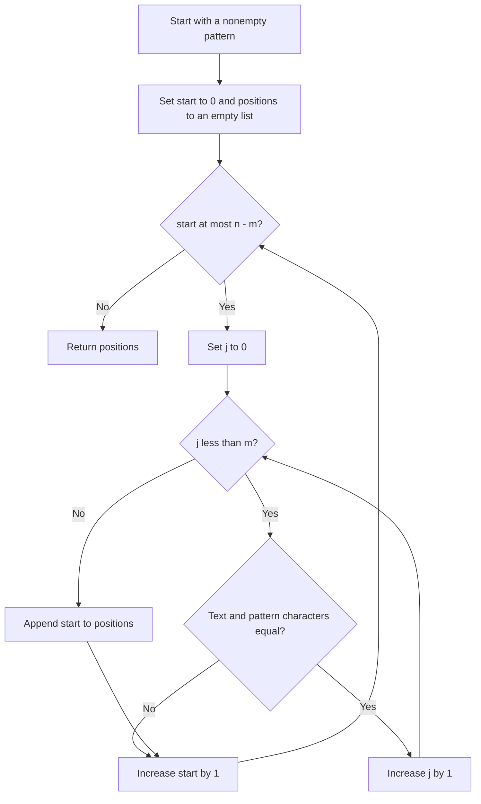
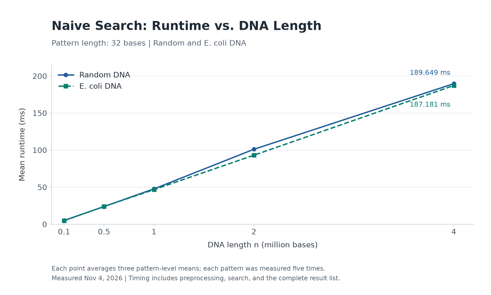
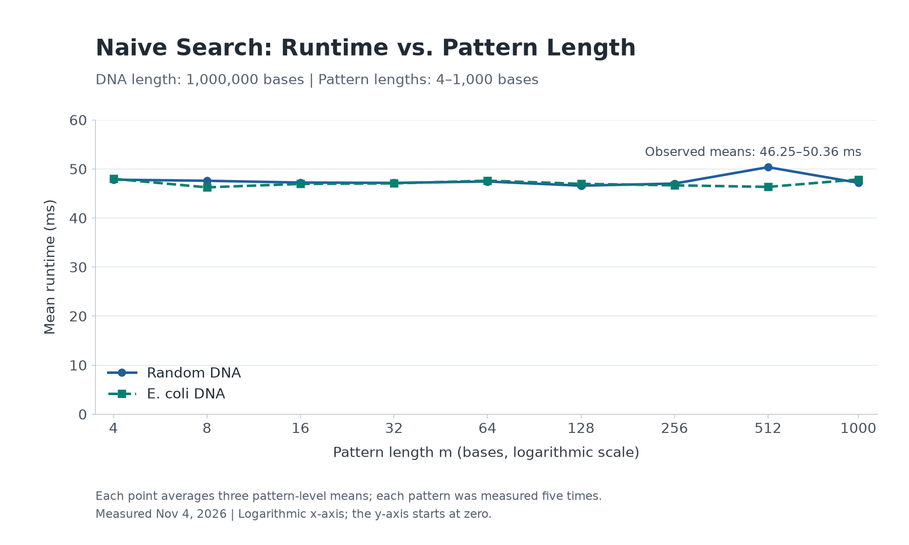
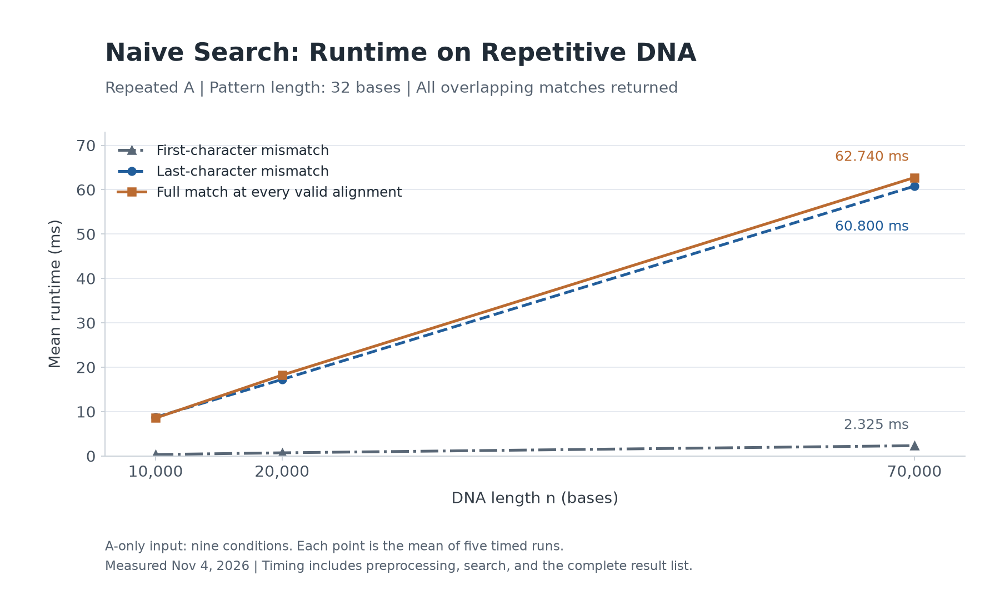

# Naive DNA Pattern Search

**Boseok Kim · Algorithms Team D1**<br>
Implementation, experimental analysis, and presentation video editing

This report documents the Naive algorithm used to find every exact occurrence of a DNA pattern, including overlapping matches. It covers the implementation, its measured behavior on random, genomic, and repetitive inputs, and the author's work on the experiment and presentation video.

[Team report](TEAM_REPORT.md) · [Source code](originals/naive.py) · [Code guide and timeline](docs/CODE_GUIDE.md) · [Presentation video](https://drive.google.com/file/d/1c0qqhO_-0Qnu68kz-zjAbLAVQG3z4FV9/view?usp=sharing)

## 1. Problem definition

For a text `T` of length `n` and a nonempty pattern `P` of length `m`, return every zero-based position `i` satisfying `T[i:i+m] == P`. Overlapping matches must be retained.

```text
Index        0 1 2 3 4 5 6 7
Text         A C A C A C G T
Start 0      A C A C          -> match
Start 1        A C A C        -> mismatch at the first character
Start 2          A C A C      -> match

Pattern: ACAC
Result:  [0, 2]
```

The genomic input is NCBI RefSeq **NC_000913.3**, *Escherichia coli* K-12 MG1655. The stored forward sequence is treated as a linear string. Approximate matching, reverse-complement search, and matches across the circular genome boundary are outside the experiment.

## 2. Implementation

The implementation checks every valid alignment from `0` through `n-m`. Characters are compared from left to right. A mismatch ends the current comparison, and a complete match adds the starting position to the result list.

The following loop is taken from [`originals/naive.py`](originals/naive.py):

```python
for start in range(len(text) - m + 1):
    j = 0
    while j < m and text[start + j] == pattern[j]:
        j += 1
    if j == m:
        positions.append(start)
```

### Control flow



### Trace of the example

| Start | Text segment | Comparison sequence | Comparisons | Result |
|---:|---|---|---:|---|
| 0 | `ACAC` | `A=A`, `C=C`, `A=A`, `C=C` | 4 | Append 0 |
| 1 | `CACA` | `C!=A` | 1 | Stop this alignment |
| 2 | `ACAC` | `A=A`, `C=C`, `A=A`, `C=C` | 4 | Append 2 |
| 3 | `CACG` | `C!=A` | 1 | Stop this alignment |
| 4 | `ACGT` | `A=A`, `C=C`, `G!=A` | 3 | Stop this alignment |

The output is `[0, 2]`, with **13 character comparisons**. Advancing the starting position by one after a match preserves overlapping occurrences.

### Interfaces and measurement

| Function | Return value | Purpose |
|---|---|---|
| `search(pattern, text)` | List of starting positions | Search and runtime measurement |
| `search_counted(pattern, text)` | `(positions, comparisons)` | Character-comparison measurement |

Both functions reject an empty pattern with `ValueError`. A pattern longer than the text returns an empty list. The counted function increments its counter for every character comparison, including the comparison that detects a mismatch. Runtime is measured with the uninstrumented function so that counter updates do not affect the recorded search time.

### Complexity

There are `n-m+1` valid starting positions when `m <= n`. At most `m` characters are compared at each position, giving worst-case time complexity **O(nm)**. A mismatch at the first character reduces the comparison work at that alignment to one comparison.

Auxiliary space is **O(1)** excluding the output. Returning `k` match positions requires **O(k)** additional space. Consequently, low preprocessing cost does not imply low total allocation when the pattern matches many positions.

## 3. Experimental method

The analysis uses the Naive rows from the archived **November 4, 2026** integrated experiment. Naive was evaluated on **111 input conditions**, with one warm-up and five timed runs per condition: **555 timed executions**. These are recorded measurements, not new timings from the preparation of this repository.

| Experiment | Variable | Fixed conditions | Cases |
|---|---|---|---:|
| DNA length | 100,000; 500,000; 1,000,000; 2,000,000; 4,000,000 bases | Pattern length 32; random and genomic DNA; three patterns per source and length | 30 |
| Pattern length | 4; 8; 16; 32; 64; 128; 256; 512; 1,000 bases | DNA length 1,000,000; two sources; three patterns per source and length | 54 |
| Repetition structure | First-character mismatch, final-character mismatch, full match | A, AC, or ACGT repeats; DNA length 10,000, 20,000, or 70,000; pattern length 32 | 27 |

The A-only repetition cases form the core analysis; the AC and ACGT cases provide supplementary conditions.

| Measurement | Scope |
|---|---|
| Environment | Windows 11, Intel Core Ultra 7 265F, Python 3.14.6 |
| Runtime | `time.perf_counter_ns()`, including search and construction of the complete output list |
| Excluded from timing | File I/O, correctness checks, comparison counting, and memory tracing |
| Comparisons | Separate instrumented run |
| Memory | One separate `tracemalloc` peak measurement per condition; output positions included, previously loaded input strings excluded |
| Correctness | Complete match-position lists checked against reference positions for all 111 Naive conditions |

Naive has no pattern-preprocessing stage. Memory values represent newly traced Python allocations during a call, rather than total process memory. The complete protocol is documented in [METHODOLOGY.md](docs/METHODOLOGY.md).

## 4. Results and analysis

### DNA length



*Each point averages three pattern-condition means; each condition mean is based on five timed runs. Pattern length is fixed at 32.*

At **4,000,000 bases**, mean runtime was **189.649 ms** for random DNA and **187.181 ms** for genomic DNA. Runtime increased approximately with text length over the tested range, consistent with checking every valid starting position.

### Pattern length



*DNA length is fixed at 1,000,000. Each point averages three pattern-condition means.*

For random DNA, increasing pattern length from **4 to 1,000** changed mean runtime from **47.816 ms to 47.181 ms**. Most attempted alignments terminated after an early mismatch, so the observed runtime did not increase in proportion to pattern length. This result describes the sampled inputs; it does not change the O(nm) worst-case bound.

### Repetitive input and mismatch position



For **70,000 repeated A bases** and a **32-base pattern**:

| Pattern condition | Mean runtime | Search comparisons |
|---|---:|---:|
| Final-character mismatch | 60.800 ms | 2,239,008 |
| First-character mismatch | 2.325 ms | 69,969 |
| Repeated full matches | 62.740 ms | 2,239,008 |

A first-character mismatch requires one comparison at each alignment. A final-character mismatch or a full match requires 32. There are `70,000 - 32 + 1 = 69,969` alignments, so the latter conditions require `69,969 × 32 = 2,239,008` comparisons. The recorded counts agree with this calculation.

The full-match condition also returns **69,969 positions**. Output construction contributes to both runtime and memory usage.

### Memory

For random DNA of length **1,000,000** and pattern length **1,000**, mean peak traced allocation was **0.289 KiB**. Naive stores no preprocessing table, but its result list grows with the number of matches. Allocation figures must therefore be interpreted together with output size.

## 5. Individual contribution

### Implementation and experimental work

- Implemented the Naive search and its separate character-counting function.
- Prepared shared DNA inputs and patterns, including normalization of the genomic sequence.
- Constructed the common benchmark and result checks used to evaluate the implementation under consistent conditions.
- Organized measured results and figures, and analyzed the effects of input length, pattern length, mismatch position, and overlapping matches.

The implementation and experiment were documented before publication. Recorded-use dates and file responsibilities are listed in the [code guide](docs/CODE_GUIDE.md); the guide distinguishes those dates from unverified original creation dates.

### Presentation video editing

Boseok Kim handled the editing and integration of the presentation materials and recorded sections into the final project video. This contribution covered assembly of the presentation deliverable in addition to the Naive implementation and experimental work.

[Watch the final presentation video](https://drive.google.com/file/d/1c0qqhO_-0Qnu68kz-zjAbLAVQG3z4FV9/view?usp=sharing)

## 6. Conclusion and limitations

Naive provides a direct implementation with no pattern preprocessing. Its measured behavior depends strongly on where mismatches occur: early mismatches terminate comparisons quickly, whereas repeated full matches and long matching prefixes cause repeated work at successive alignments.

The results are limited to one machine, one Python implementation, and 111 selected conditions. They do not establish performance for approximate genomic alignment or for other languages and hardware. Independent benchmark sessions and additional input distributions would be needed to assess broader variability.

## 7. Running the code

Python **3.10 or later** is required. The search functions and example use only the standard library.

From the repository root:

```sh
python -B examples/naive_demo.py
```

The example prints match positions and comparison counts for overlapping and repetitive inputs. A direct call is also available:

```sh
python -c "from originals.naive import search; print(search('ACAC', 'ACACACGT'))"
```

Expected output: `[0, 2]`.

The [team report](TEAM_REPORT.md#6-implementation-and-reproducibility) provides the full benchmark and archived-results verification commands. Repository files and their recorded use are described in [CODE_GUIDE.md](docs/CODE_GUIDE.md).

## 8. Sources and tool use

- **Genomic input:** [NCBI RefSeq NC_000913.3](https://www.ncbi.nlm.nih.gov/nuccore/NC_000913.3), *Escherichia coli* K-12 MG1655. See [data provenance](docs/DATA.md).
- **Memory measurement:** Python documentation for [`tracemalloc`](https://docs.python.org/3.14/library/tracemalloc.html).
- **Measurements:** [Summary data](results/20261104/summary.csv), [individual runs](results/20261104/runs.csv), and [condition definitions](results/20261104/conditions.csv), recorded on November 4, 2026. The figures above filter the saved data to Naive; their source is [the plotting script](code/plot_figures.py).
- **AI assistance:** OpenAI Codex assisted with data preparation, benchmark tooling, verification, figure generation, and report and repository documentation. 
