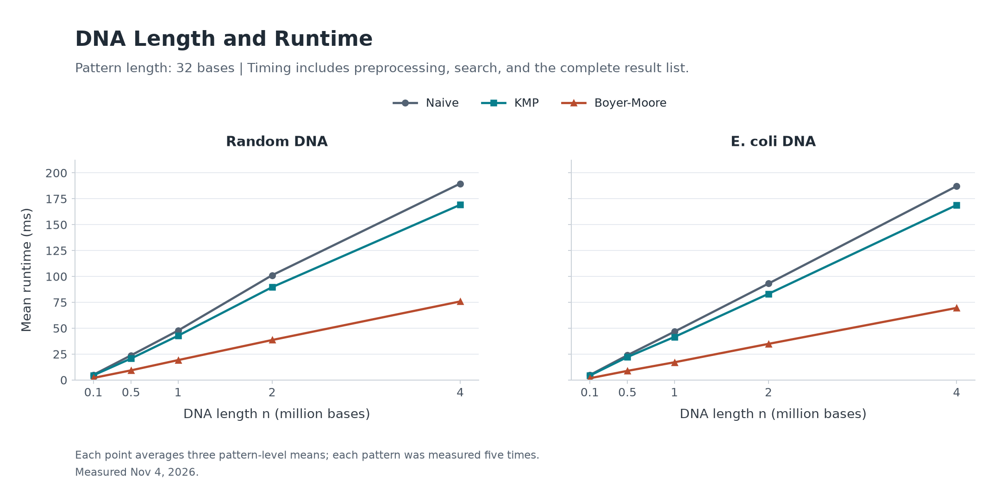
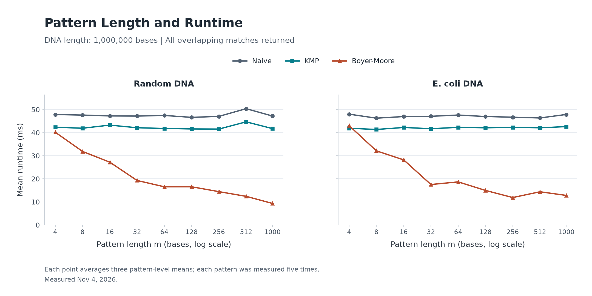
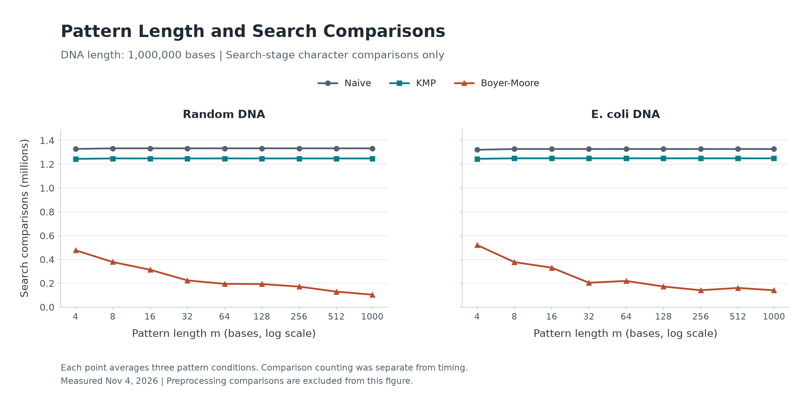
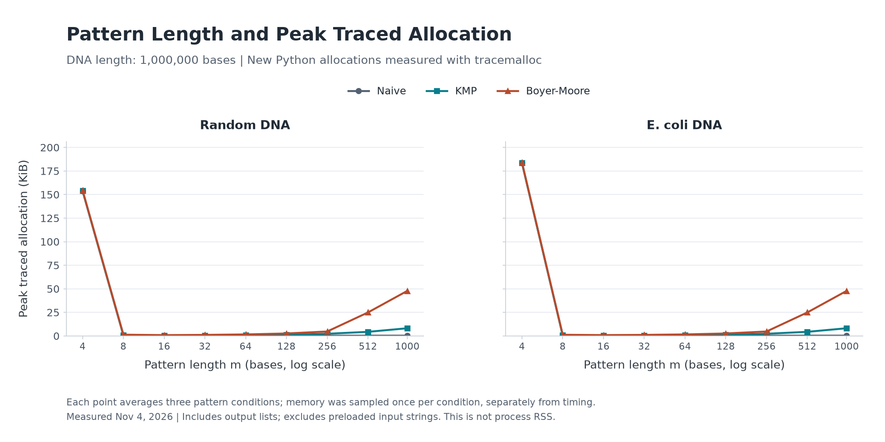
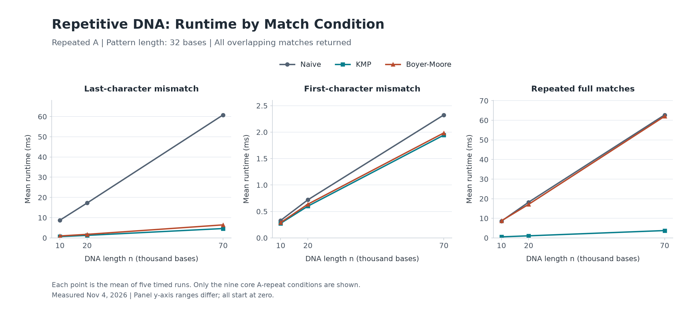

# Team Report: DNA Pattern Search

**Experimental report on exact string matching in random, E. coli, and repetitive DNA**

This report compares three Python implementations of exact string matching. Boyer–Moore had the lowest runtime on most of the random and E. coli inputs. KMP had substantially lower runtime when a short pattern matched repeatedly across the text. Algorithm performance varied with pattern length and repetition structure.

**Team:** D1 — Boseok Kim, Seonha Baek, Seokjin Lee<br>
**Experiment date:** November 4, 2026<br>
**Measured environment:** Python 3.14.6 on Windows 11<br>
**Topics:** exact string matching · DNA sequences · Naive · Knuth–Morris–Pratt · Boyer–Moore

**[Presentation video](https://drive.google.com/file/d/1c0qqhO_-0Qnu68kz-zjAbLAVQG3z4FV9/view?usp=sharing)** · [Naive implementation and individual contribution](README.md)

## 1. Problem definition

For a DNA text **T** of length **n** and a nonempty pattern **P** of length **m**, the objective is to return **every zero-based start position** satisfying `T[i:i+m] == P`. Overlapping occurrences are included. For example, searching for `AAA` in `AAAAA` returns `[0, 1, 2]`.

Search cost depends on the input. Longer sequences increase the number of possible alignments, and repeated prefixes can cause repeated character comparisons. Longer patterns may require more comparisons at a single alignment while permitting larger shifts after a mismatch.

The comparison addresses four factors:

1. Runtime as DNA sequence length increases.
2. The effect of pattern length on each algorithm.
3. The effects of text repetition, mismatch position, and repeated full matches.
4. Runtime and memory trade-offs in the Python implementations.

All three algorithms used the **same input texts, patterns, and correctness checks**. The task is exact substring search, not biological sequence alignment with substitutions, insertions, or deletions.

## 2. Algorithms

| Algorithm | Search strategy | Strength | Trade-off |
|:--|:--|:--|:--|
| **Naive** | Tries each alignment and compares from left to right. | Simple baseline with no pattern preprocessing. | Worst-case **O(nm)** character comparisons; long repeated prefixes cause repeated work. |
| **Knuth–Morris–Pratt (KMP)** | Builds a longest proper prefix/suffix (**LPS**) table and reuses information from earlier matches. | **O(n + m)** preprocessing and search time, including repetitive inputs [1]. | Uses **O(m)** preprocessing space, excluding results; linear complexity does not always mean the lowest measured runtime. |
| **Boyer–Moore** | Compares from right to left and shifts using **bad-character** and **strong good-suffix** information [2]. | Can skip many alignments on suitable inputs. | Requires preprocessing and extra storage. The evaluated implementation does **not** use the Galil rule, so repeated full matches can cause extensive rechecking. |

The Boyer–Moore implementation uses both shift heuristics. All implementations return the complete list of matches, including overlaps. These implementation choices affect performance on repetitive inputs.

The implementation files are [`naive.py`](originals/naive.py), [`kmp.py`](originals/kmp.py), and [`boyer_moore.py`](originals/boyer_moore.py). The common benchmark uses a separate [`kmp_timed.py`](code/kmp_timed.py) with comparison-counter operations removed for timing and memory measurements. See the [code guide](docs/CODE_GUIDE.md) for the repository's implementation files.

## 3. Experimental design

The experiment comprised **111 input conditions**. Each algorithm–condition combination included one warm-up run followed by five timed runs, for **1,665 timed executions** in total.

| Experiment | Controlled variation | Input data | Conditions |
|:--|:--|:--|--:|
| **1. DNA length** | 100,000; 500,000; 1,000,000; 2,000,000; 4,000,000 bases | Random and E. coli DNA; 32-base patterns; three patterns per size and source | 30 |
| **2. Pattern length** | 4, 8, 16, 32, 64, 128, 256, 512, 1,000 bases | Random and E. coli DNA fixed at 1,000,000 bases; three patterns per size and source | 54 |
| **3. Repetitive DNA** | Mismatch at the final pattern character; mismatch at the first character; repeated full matches | Synthetic `A`, `AC`, and `ACGT` repeats; DNA lengths 10,000, 20,000, 70,000; pattern length 32 | 27 |
| **Total** | | | **111** |

The genomic DNA source is **NCBI RefSeq NC_000913.3**, the E. coli K-12 MG1655 genome [4]. Data provenance and preparation are described in [the data guide](docs/DATA.md). The stored sequence is treated as a linear string. Reverse-complement and circular-boundary searches are excluded.

### Environment and measurement scope

| Item | Configuration |
|:--|:--|
| CPU | Intel Core Ultra 7 265F |
| Operating system | Windows 11 |
| Python | 3.14.6 |
| Clock | `time.perf_counter_ns()`; reported in milliseconds |
| Repetition | 1 warm-up + 5 timed runs per algorithm and condition |
| Included in timing | Pattern preprocessing, search, and construction of the full result-position list |
| Excluded from timing | File I/O, correctness validation, comparison counters, and memory tracing |
| Character comparisons | Preprocessing and search counted separately; the comparison chart shows **search-stage** counts |
| Peak memory | Python `tracemalloc`, measured separately: peak **new traced Python allocations** during one call, including output positions and excluding previously loaded input strings [3] |
| Correctness | Complete zero-based, overlapping match-position lists checked against reference results |

Case order was shuffled with seed `20261104`, and algorithm execution order was rotated. Cyclic garbage collection was disabled during timed calls. The KMP timing version retains the original LPS and search control flow with comparison-counter operations removed. Comparison counts were obtained from the original implementation.

All **333 algorithm–condition combinations** passed the recorded full-position correctness checks. The results apply to these implementations and this measurement protocol; they do not establish a ranking across languages or implementations.

## 4. Results and interpretation

Figures 1–5 were recreated in English from the archived November 4 CSV measurements. No new performance run was used to produce these figures.

### Experiment 1: DNA length



*Figure 1. Mean runtime with 32-base patterns. Each point averages the means of three pattern conditions for the corresponding source and length. Recreated from the archived [condition summaries](results/20261104/summary.csv).*

At **4,000,000 bases**, the mean runtimes were:

| Input | Naive (ms) | KMP (ms) | Boyer–Moore (ms) |
|:--|--:|--:|--:|
| Random DNA | 189.649 | 169.181 | **75.848** |
| E. coli DNA | 187.181 | 168.939 | **69.597** |

Runtime increased approximately with sequence length over the tested range, with different rates of increase among the algorithms. At 4 million bases, the Naive-to-Boyer–Moore runtime ratio was approximately **2.50×** for random DNA and **2.69×** for E. coli DNA.

For these inputs and 32-base patterns, reduced search work from skipped alignments outweighed Boyer–Moore's preprocessing cost. This observation is limited to the tested inputs and does not establish the same result for all DNA sequences.

### Experiment 2: pattern length



*Figure 2. Mean runtime across nine pattern lengths, with DNA length fixed at 1,000,000 bases. Each point averages three pattern conditions. Recreated from the archived CSV measurements.*

| Input / pattern | Naive (ms) | KMP (ms) | Boyer–Moore (ms) |
|:--|--:|--:|--:|
| Random DNA / 4 bases | 47.816 | 42.326 | **40.163** |
| Random DNA / 32 bases | 47.161 | 42.107 | **19.268** |
| Random DNA / 1,000 bases | 47.181 | 41.736 | **9.323** |
| E. coli DNA / 4 bases | 47.984 | **41.879** | 43.013 |
| E. coli DNA / 32 bases | 47.063 | 41.698 | **17.519** |
| E. coli DNA / 1,000 bases | 47.862 | 42.605 | **12.792** |

Naive and KMP runtimes changed relatively little as pattern length increased from 4 to 1,000 bases. Boyer–Moore runtime decreased substantially. On random DNA, its mean runtime decreased from **40.163 ms** to **9.323 ms**, corresponding to a runtime ratio of approximately **4.31×**. At a pattern length of 1,000, the Naive-to-Boyer–Moore runtime ratio was approximately **5.06×**.

For E. coli patterns of length 4, **KMP had slightly lower runtime than Boyer–Moore**. Short patterns provide fewer opportunities for large shifts, which can increase the relative contribution of preprocessing and Python control-flow costs.

#### Search-stage character comparisons



*Figure 3. Mean search-stage character comparisons, in millions. Preprocessing comparisons were recorded separately and are excluded here. Recreated from the archived CSV measurements.*

For random DNA and **1,000-base patterns**, the mean search-stage comparison counts were approximately:

- **Naive:** 1.333 million
- **KMP:** 1.248 million
- **Boyer–Moore:** 0.104 million

Boyer–Moore's lower comparison count is consistent with its right-to-left search and larger alignment shifts. Runtime is not directly proportional to the comparison count because preprocessing, branches, list operations, and interpreter overhead also contribute.

#### Peak Python allocation



*Figure 4. Mean peak traced Python allocations in KiB, measured separately from timing. Input strings loaded before the call are excluded; result-position lists are included. Recreated from the archived CSV measurements.*

For **random DNA with a 1,000-base pattern**:

| Algorithm | Peak new Python allocation (KiB) |
|:--|--:|
| Naive | **0.289** |
| KMP | 8.141 |
| Boyer–Moore | 47.799 |

Boyer–Moore's measured peak allocation was approximately **5.87×** KMP's in this setting, reflecting its larger preprocessing structures. The **4-base random-DNA patterns** produced approximately **3,887 matches on average**. Storage of these positions increased the peak allocation of all three implementations to approximately **154 KiB**.

Peak allocation includes both preprocessing structures and returned results. These values are **not total process memory**. Memory was sampled once per algorithm and condition, separately from the five timing runs. Chart averages combine the relevant pattern conditions.

### Experiment 3: repetitive DNA



*Figure 5. Runtime on A-only DNA with 32-base patterns. The panels show a final-character mismatch, a first-character mismatch, and repeated full matches. The wider experiment also includes AC and ACGT repeats. Recreated from the archived CSV measurements.*

At **70,000 repeated A bases**:

| Pattern condition | Naive (ms) | KMP (ms) | Boyer–Moore (ms) |
|:--|--:|--:|--:|
| Mismatch at final character | 60.800 | **4.619** | 6.431 |
| Mismatch at first character | 2.325 | **1.944** | 1.985 |
| Repeated full matches | 62.740 | **3.735** | 62.030 |

The repeated-full-match condition produced **69,969 overlapping matches**. KMP made **70,000 search-stage character comparisons**, while Naive and Boyer–Moore each made **2,239,008**. The Boyer–Moore-to-KMP runtime ratio was approximately **16.6×**.

Repeated full matches limit the alignment-skipping advantage of the evaluated Boyer–Moore implementation. Without the Galil optimization, matching characters are checked repeatedly. KMP uses its LPS table to continue after a match without repeating all previous comparisons.

Naive runtime also depends on mismatch position. A first-character mismatch terminates each attempted match immediately. A final-character mismatch requires comparison of almost the entire pattern beforehand. The runtime difference between these conditions cannot be explained by input length alone.

## 5. Discussion and conclusions

| Situation | Choice supported by these tests | Reason |
|:--|:--|:--|
| Long random or E. coli DNA with medium or long patterns | **Boyer–Moore** | Skipped alignments and fewer comparisons produced lower measured runtimes. |
| Highly repetitive DNA with many overlapping full matches | **KMP** | Reused matching-prefix information and avoided repeated full-pattern comparisons. |
| Very short patterns | **Measure on the intended inputs** | KMP was slightly faster than Boyer–Moore for 4-base E. coli patterns. |
| A simple baseline with minimal preprocessing storage | **Naive** | Small implementation and low auxiliary allocation, though repeated comparisons can be expensive. |

The comparison identifies trade-offs among **runtime, preprocessing storage, and implementation complexity**. Boyer–Moore uses additional preprocessing storage to reduce search work. KMP reduces repeated comparisons on repetitive inputs. Naive provides a simple baseline for measuring the cost of repeated comparisons. All three implementations require storage for returned match positions.

### Limitations

- **One machine and one language.** Python, hardware, and implementation choices affect runtime. These results do not establish a universal ranking.
- **A limited set of inputs.** The 111 conditions cover selected random, E. coli, and synthetic repetitive sequences, not every DNA or pattern distribution. The E. coli source is NC_000913.3 [4].
- **Measurement scope.** Comparison counting and memory tracing are excluded from timed runs. Traced Python allocations do not represent RSS or total process memory.
- **All matches are returned.** Output size can dominate memory and contribute to runtime. These results should not be compared directly with APIs that stop at the first match.
- **Exact matching only.** The experiment does not handle substitutions, insertions, deletions, reverse complements, or matches across the genome's circular boundary.
- **A specific Boyer–Moore variant.** The evaluated implementation uses bad-character and strong good-suffix rules without the Galil rule. Its repetitive-input result should not be generalized to every optimized variant.

### Further work

Further evaluation may include more genomes and larger inputs, confidence intervals from independent benchmark sessions, comparison of traced allocations with process RSS, and an implementation of the Galil rule. Approximate matching would extend the scope to related sequences containing mutations or gaps.

## 6. Implementation and reproducibility

This team report and the individual Naive portfolio use the same saved benchmark results. The repository separates the original algorithm implementations, the common measurement code, and the recorded data:

```text
.
├── README.md                    # Naive implementation and individual contribution
├── TEAM_REPORT.md               # Team comparison and benchmark instructions
├── originals/                   # Naive, KMP, and Boyer–Moore implementations
├── code/                        # Common runner and measurement helpers
├── inputs/                      # Frozen DNA and pattern inputs
├── reference/                   # Case definitions and expected match positions
├── data/                        # E. coli sequence and provenance
├── docs/                        # Data and measurement documentation
├── figures/team/                # English figures recreated from archived CSVs
└── results/20261104/
    ├── conditions.csv           # 111 input conditions
    ├── runs.csv                 # 1,665 timed runs
    ├── summary.csv              # 333 algorithm–condition summaries
    └── charts/                  # Original archived figures
```

The recorded data consist of [condition summaries](results/20261104/summary.csv), [individual timed runs](results/20261104/runs.csv), and [experiment definitions](results/20261104/conditions.csv). Measurement scope is documented in the [measurement guide](docs/METHODOLOGY.md).

### Requirements

**Python 3.10 or later** is required. The search implementations, common benchmark, and result verifier use only Python standard-library modules. No additional packages are required for the commands below. The archived measurements were collected with Python 3.14.6; the minimum version required to run the code is separate from that measured environment.

Reproduction requires the included `originals/`, `inputs/`, `reference/`, and `snapshot_manifest.json` files. The original algorithm files use different function signatures and standalone entry points, so the common runner provides the interface for comparing all three implementations.

Run the following commands from the repository root. Use `python3` instead of `python` if that is the Python 3 command on the local system. The `-X utf8` option enables UTF-8 text handling. Validation uses assertions, so the commands should be run without `-O` or `-OO`.

### Validate all input conditions

```bash
python -B -X utf8 code/run_benchmark.py --validate-only
```

This command verifies the preserved file hashes, all 111 input conditions, reference match positions, and the outputs of both the timed and instrumented implementations. It does not collect new timing measurements.

### Verify the archived measurements

```bash
python -B -X utf8 code/verify_results.py results/20261104
```

The verifier checks the 333 algorithm–condition summaries and 1,665 timed runs. It recomputes summary statistics from the recorded runtimes and checks measurement order, match counts, position hashes, and source integrity. The command updates `results/20261104/verification.json`; it does not change the CSV measurements or perform a new benchmark. The recorded CSV files can also be inspected directly through the links above.

### Run a new benchmark

```bash
python -B -X utf8 code/run_benchmark.py --repeats 5
```

New results are written to a timestamped directory under `results/`, and the directory path is printed when the run completes. The archived `results/20261104/` measurements remain separate. The same result-verification command can be applied to a new run by replacing `results/20261104` with its printed directory path.

Runtimes may differ from the November 4 results because of the machine, Python version, and background load. The source of the genome and its preparation are documented in [the data guide](docs/DATA.md).

## 7. Team and contributions

The table summarizes the main responsibilities. Discussion and review were shared team activities. Detailed Naive implementation and individual work are documented in the linked README. The other team members' repository URLs have not been provided.

| Contributor | Individual work | Main responsibility |
|:--|:--|:--|
| Boseok Kim (김보석) | [Naive implementation and individual contribution](README.md) | Naive implementation; shared data and benchmark; presentation and video editing. |
| Seonha Baek (백선하) | Not provided | KMP implementation; correctness testing and result analysis. |
| Seokjin Lee (이석진) | Not provided | Boyer–Moore implementation; shift and overlap checks and runtime analysis. |

Each member contributed the explanation, script, and recording for their assigned presentation sections.

**AI assistance.** OpenAI Codex assisted with data preparation, the common benchmark runner, the counter-free KMP measurement variant, validation, report preparation, and repository organization. AI assistance is acknowledged separately from the team members' contributions. The reported measurements come from the saved team benchmark data.

## References

1. Knuth, D. E., Morris, J. H., Jr., & Pratt, V. R. (1977). [Fast Pattern Matching in Strings](https://doi.org/10.1137/0206024). *SIAM Journal on Computing, 6*(2), 323–350.
2. Boyer, R. S., & Moore, J. S. (1977). [A Fast String Searching Algorithm](https://doi.org/10.1145/359842.359859). *Communications of the ACM, 20*(10), 762–772.
3. Python Software Foundation. [`tracemalloc` — Trace memory allocations](https://docs.python.org/3.14/library/tracemalloc.html). *Python 3.14 documentation.*
4. NCBI RefSeq. [Escherichia coli str. K-12 substr. MG1655, complete genome — NC_000913.3](https://www.ncbi.nlm.nih.gov/nuccore/NC_000913.3).

**Experimental source:** D1 team benchmark, November 4, 2026. The tables and figures use the saved [raw measurements](results/20261104/runs.csv), [aggregated metrics](results/20261104/summary.csv), and [condition definitions](results/20261104/conditions.csv).
