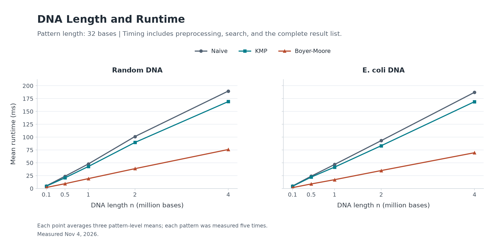
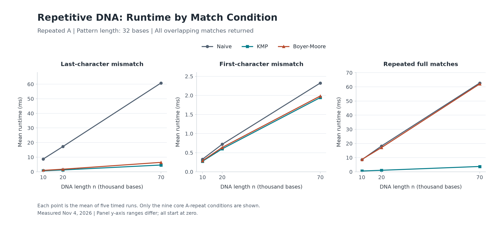

# Archived integrated experiment results

**Measurement date: November 4, 2026.** These values come from the archived [`summary.csv`](../results/20261104/summary.csv). Repository packaging and documentation revisions did not replace them with new timings.

## Representative results

In Experiment 1, with `n = 4,000,000` and `m = 32`, each value below averages the five-run means of three pattern conditions.

| Input | Naive | KMP | Boyer–Moore |
|---|---:|---:|---:|
| Random DNA | 189.649 ms | 169.181 ms | 75.848 ms |
| *E. coli* DNA | 187.181 ms | 168.939 ms | 69.597 ms |



The ranking changed for the `A`-repeat full-match condition in Experiment 3, with `n = 70,000` and `m = 32`.

| Algorithm | Mean runtime | Search character comparisons |
|---|---:|---:|
| Naive | 62.740 ms | 2,239,008 |
| KMP | 3.735 ms | 70,000 |
| Boyer–Moore | 62.030 ms | 2,239,008 |

This condition returns all overlapping matches. KMP reuses matched-prefix information after each match. The tested Boyer–Moore implementation has no Galil rule and compares characters again at overlapping full-match positions.



Across the 111 constructed conditions, Boyer–Moore had the lowest mean time in 92 conditions and KMP in 19; Naive had the lowest mean in none. These counts describe this input collection and these implementations. They are not a universal ranking of the algorithms.

## Measurement files

| File | Contents |
|---|---|
| [`conditions.csv`](../results/20261104/conditions.csv) | 111 input conditions, with text and pattern hashes. |
| [`runs.csv`](../results/20261104/runs.csv) | 1,665 individual timing records, execution order, and match counts. |
| [`summary.csv`](../results/20261104/summary.csv) | 333 algorithm-condition summaries, comparison counts, and memory measurements. |
| [`metadata.json`](../results/20261104/metadata.json) | The recorded environment and protocol, historical code hashes, and separate package-code hashes. |
| [`source_verification.json`](../results/20261104/source_verification.json) | The historical verification record. Its metadata hash refers to the original file before personal paths were removed for packaging. |
| [`verification.json`](../results/20261104/verification.json) | Verification output for the packaged inputs, raw measurements, statistics, and code. Running the verifier updates this file. |

The saved timing statistics and expected-position hashes can be checked again without collecting new timings:

```sh
python -B -X utf8 code/verify_results.py results/20261104
```

This checks the saved records and recomputes statistics from the raw timings. It does not remeasure the historical comparison counts or memory values. See [METHODOLOGY.md](METHODOLOGY.md) for measurement boundaries and [CODE_GUIDE.md](CODE_GUIDE.md) for the source-use timeline.
